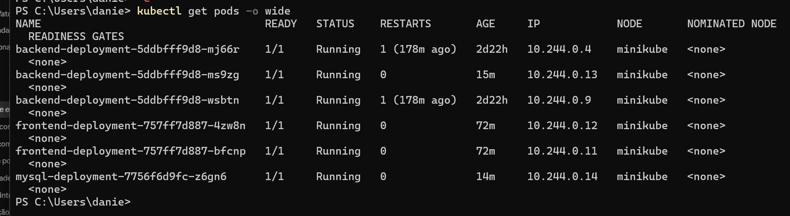
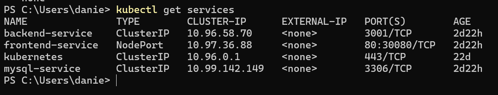
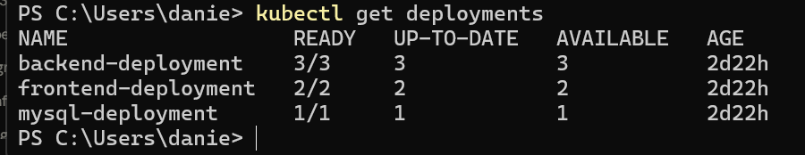
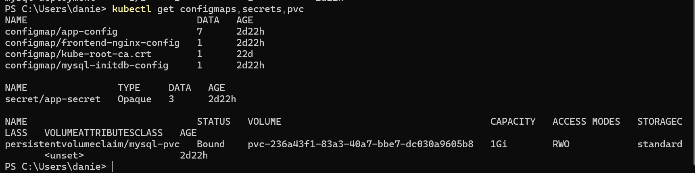
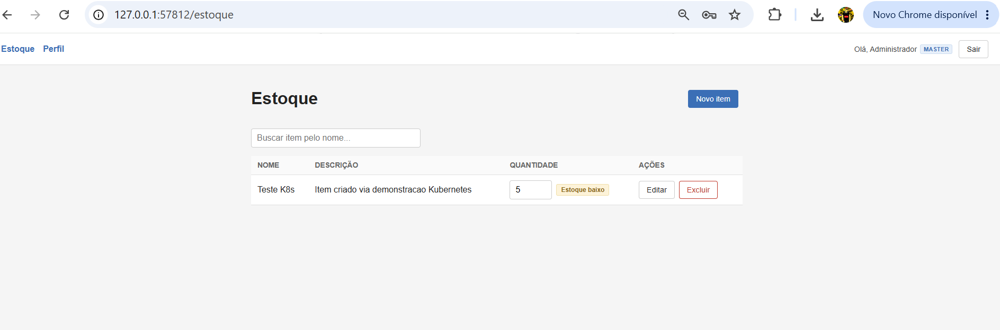
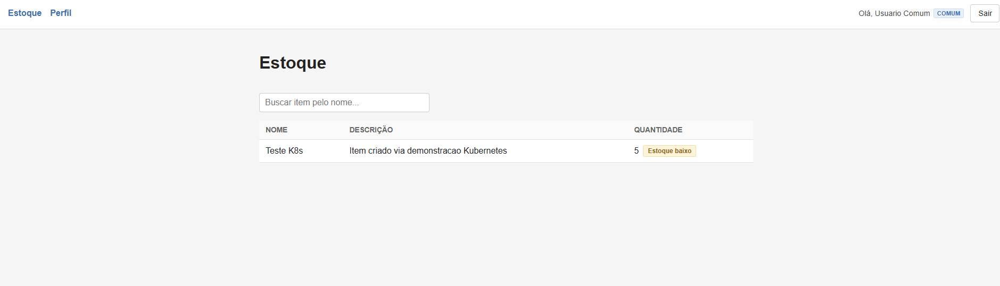
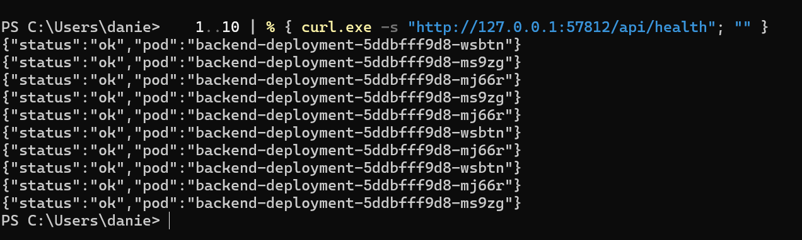
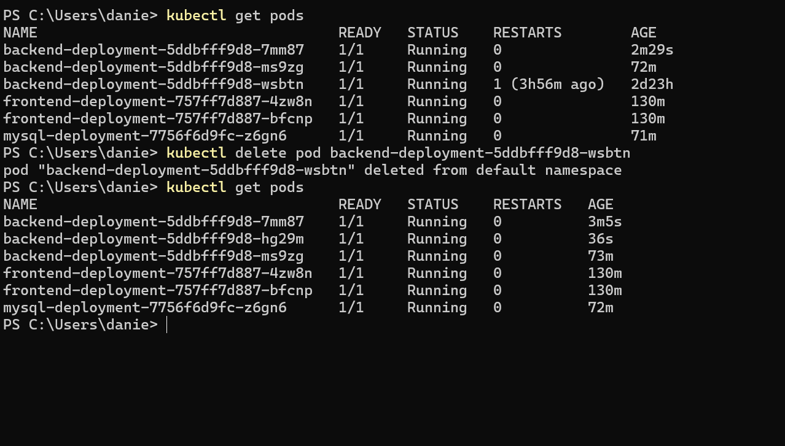

# Evidências da migração para Kubernetes

Prints da demonstração do projeto rodando no Minikube (ver passo a passo completo em
`README.md`, seção "Kubernetes (Minikube)").

1. `kubectl get pods -o wide` — 3 réplicas do backend, 2 do frontend e 1 do MySQL, todas `Running`/`READY`, com IPs e node.
   

2. `kubectl get services` — `frontend-service` como `NodePort` (30080) e `backend-service`/`mysql-service` como `ClusterIP`.
   

3. `kubectl get deployments` — `READY` igual ao total de réplicas em cada Deployment.
   

4. `kubectl get configmaps,secrets,pvc` — ConfigMaps, o Secret `app-secret` e o PVC `mysql-pvc` (`Bound`, 1Gi).
   

5. Aplicação logada como usuário master (`admin@estoque.com`), com as ações de criar/editar/excluir item visíveis.
   

6. Aplicação logada como usuário comum (`comum@estoque.com`), só em modo leitura, sem as ações de master.
   

7. Teste de balanceamento — 10 chamadas a `/api/health` respondendo com Pods diferentes do backend a cada requisição.
   

8. Recriação automática — `kubectl delete pod` num Pod do backend seguido de `kubectl get pods` mostrando o Deployment recriando outro no lugar.
   
